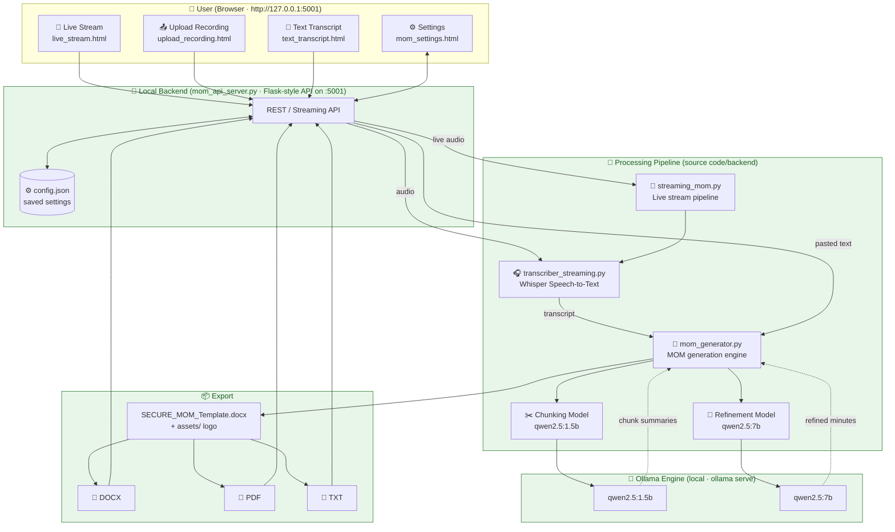

<div align="center">

# 🎙️ MOM Generator

### AI-Powered Minutes of Meeting — 100% Offline

**Record or upload a meeting → get polished DOCX, PDF and TXT minutes. Nothing ever leaves your PC.**


*No cloud. No subscriptions. No API keys. No data leaks.*

</div>

---

## 📑 Table of Contents

1. [Why MOM Generator?](#-why-mom-generator)
2. [Features](#-features)
3. [Architecture](#-architecture)
4. [Quick Start (Installation)](#-quick-start-guide)
5. [Configuration & Settings](#%EF%B8%8F-configuration--settings)
6. [Folder Structure](#-folder-structure)
7. [Troubleshooting](#%EF%B8%8F-troubleshooting--common-errors)
8. [Manual Server Startup](#-manual-server-startup-advanced)
9. [Security & Privacy](#-security--privacy)

---

## ✨ Why MOM Generator?

Meeting minutes are tedious, and uploading confidential discussions to a cloud AI is often not an option. MOM Generator runs the **entire pipeline locally** — speech-to-text, summarisation and document export — so sensitive boardroom, engineering and HR conversations stay on your machine.

| | Cloud tools | **MOM Generator** |
|---|:---:|:---:|
| Works without internet | ❌ | ✅ |
| Audio/transcripts leave your PC | ⚠️ Yes | ✅ Never |
| Subscription / per-minute fees | 💸 Yes | ✅ Free |
| Branded DOCX template output | ➖ | ✅ |
| Configurable local models | ➖ | ✅ |

---

## 🚀 Features

- 🔴 **Live Streaming Transcription** — capture a meeting in real time from your microphone.
- 📤 **Audio Upload** — drop in a recording (up to **180 minutes**).
- 📝 **Text Transcript Input** — paste an existing transcript (up to **1,000,000 characters**).
- 🧠 **Two-stage local AI** — a fast *chunking* model plus a higher-quality *refinement* model.
- 📄 **Multi-format export** — branded **DOCX**, **PDF** and **TXT**.
- 🎯 **Target word limit** — control MOM length (default **500 words**).
- 🌗 **Light / Dark / Auto theme.**
- 💾 **Auto-saved settings** — configure everything from the UI, no code edits.
- 🔄 **Auto model updates** — `START_APP` refreshes your AI models in the background.

---

## 🏗️ Architecture

Everything below runs on `localhost`. The only network traffic is between your browser and the local server, and between the server and the local Ollama engine.



### 🔄 How a meeting becomes minutes

```text
 🎤 Audio / 📝 Text
        │
        ▼
 ┌───────────────┐   ┌────────────────┐   ┌─────────────────┐   ┌──────────────┐
 │ 1. Transcribe │ → │ 2. Chunk       │ → │ 3. Refine       │ → │ 4. Export    │
 │   (Whisper)   │   │ (qwen2.5:1.5b) │   │ (qwen2.5:7b)    │   │ DOCX/PDF/TXT │
 └───────────────┘   └────────────────┘   └─────────────────┘   └──────────────┘
        └──────────────── all on your machine · zero cloud calls ────────────────┘
```

| Stage | Component | Role |
|---|---|---|
| 1 | Whisper (`transcriber_streaming.py`) | Converts live or uploaded audio to text |
| 2 | `qwen2.5:1.5b` | Fast chunking of long transcripts into manageable segments |
| 3 | `qwen2.5:7b` | Higher-quality refinement into structured minutes |
| 4 | `mom_generator.py` + DOCX template | Builds branded DOCX, PDF and TXT output |

---

## 🚀 Quick Start Guide

### Step 1: One-Time Installation
You only need to do this the very first time you download the application.

**For Windows:**
```text
📁 MOM-main
  └── 📁 install
        └── 📁 Installation-Windows
              └── ▶️  setup.bat   ← Double-click this ONCE
```
A black terminal window will open. **Wait for it to finish.** It will automatically install Python, the Ollama AI engine, and download the necessary AI models (approx. 6 GB). The offline-based Ollama AI model download can sometimes take more time on lower-configuration PCs. In such a case, manually install the models with the following commands:

Let the installation continue in the original terminal, and run the following commands in **another terminal window** only after Ollama has installed successfully.

1. `ollama --version` (check the currently installed Ollama version)
2. `ollama pull qwen2.5:1.5b` (download the Chunking Model)
3. `ollama pull qwen2.5:7b` (download the Refinement Model)
4. `ollama list` (after the downloads finish, verify both models are present)
5. `ollama serve` (check that the server starts, once you click the START_APP file after successful installation)

> ⏱️ *This can take 15–25 minutes depending on your internet speed. Grab a coffee!*

**For macOS:**
```text
📁 MOM-main
  └── 📁 install
        └── 📁 Installation-MacOS
              └── 🍎 setup.sh      ← Run this in Terminal ONCE
```
Wait for the installation to complete in your terminal.

### Step 2: Running the Application (Daily Use)
Every time you want to use the MOM Generator:

**For Windows:**
```text
📁 MOM-main
  └── 📁 START_APP
        └── ▶️  START_APP.bat   ← Double-click this every time
```
> 🔄 *This script will also automatically update your AI models in the background if a newer version is available!*

**For macOS:**
```text
📁 MOM-main
  └── 📁 START_APP
        └── 🍎 START_APP.sh    ← Run this in Terminal every time
```

### Step 3: Accessing the App
Once the server starts, your default web browser will automatically open to:

👉 **http://127.0.0.1:5001**

Keep the black terminal window open while you are using the app. When you are finished, simply close the terminal window to shut down the server.

---

## ⚙️ Configuration & Settings

Customize almost everything directly from the app — no code changes needed.

1. Open the app in your browser (http://127.0.0.1:5001).
2. Click the **⚙️ Settings** icon in the top right corner.
3. Changes are **auto-saved** instantly to `config.json`.

| Setting | What it does |
|---|---|
| 🤖 **AI Models** | Switch local models: `qwen2.5:1.5b` for speed, `qwen2.5:7b` for quality |
| ⏱️ **Audio Limit** | Max upload length, up to 180 minutes |
| 📏 **Transcript Limit** | Max text length, up to 1,000,000 characters |
| 🎯 **Word Limit** | Target words per generated MOM (default 500) |
| 🌗 **Theme** | Light, Dark, or Auto (follows your system) via the sun/moon icon |

---

## 📁 Folder Structure

```text
📁 MOM-main/
│
├── 📁 START_APP/
│     ├── ▶️  START_APP.bat          ← Launch app on Windows (use daily)
│     └── 🍎 START_APP.sh           ← Launch app on macOS (use daily)
│
├── 🐍  mom_api_server.py           ← Main backend Python server
├── ⚙️  config.json                 ← Saved application settings
├── 📄  README.md                   ← This guide
├── 🔐  SECURITY.md                 ← Security & privacy policy
│
├── 📁 install/
│     ├── 📁 Installation-Windows/  ← Windows setup scripts
│     └── 📁 Installation-MacOS/    ← macOS setup scripts
│
└── 📁 source code/                 ← Application Source Files
      │
      ├── 📁 assets/                ← Images (e.g. SECURE Logo for DOCX templates)
      │
      ├── 📁 backend/               ← AI & Processing Logic
      │     ├── mom_generator.py          (MOM generation engine)
      │     ├── streaming_mom.py          (Live stream pipeline)
      │     ├── transcriber_streaming.py  (Whisper STT engine)
      │     ├── SECURE_MOM_Template.docx  (Base format for exports)
      │     └── ...
      │
      └── 📁 frontend/              ← Web User Interface (HTML/CSS/JS)
            ├── index.html                (Home page)
            ├── live_stream.html          (Live Audio page)
            ├── upload_recording.html     (Audio Upload page)
            ├── text_transcript.html      (Text Input page)
            └── mom_settings.html         (Settings page)
```

---

## 🛠️ Troubleshooting & Common Errors

| # | Symptom | Fix |
|---|---|---|
| 1 | `setup.bat` fails immediately | Right-click `setup.bat` → **Run as Administrator** |
| 2 | "Python not found" / "Ollama not found" | **Restart your PC** after the first install so Windows registers the new software, then run `setup.bat` again |
| 3 | Terminal shows red `ConnectionError` / `Connection Refused` | Ollama is probably restarting or auto-updating. Wait a minute or two — the app reconnects automatically |
| 4 | Browser says "Site not reachable" | The server is still loading models. Wait **15–30 seconds** after launching `START_APP.bat`, then refresh |
| 5 | MOM generation gets stuck or fails | Close the terminal and re-run `START_APP.bat`. Ensure at least **8 GB of free RAM** — AI models are memory-hungry |

---

## 👨‍💻 Manual Server Startup (Advanced)

To bypass the automatic startup scripts or troubleshoot:

1. Open a terminal in the main `MOM-main` folder.
2. Run the Python backend server:
   ```bash
   python mom_api_server.py
   ```
3. Open your browser and go to `http://127.0.0.1:5001`.

> Make sure Ollama is already running (`ollama serve`) when using this manual method.

---

## 🔐 Security & Privacy

- All audio, transcripts and generated minutes are processed **locally**; no cloud APIs are called.
- The app is intended to be reached only at `127.0.0.1` (your own machine).
- Internet access is needed only during **installation** and optional **model updates**.

For the full policy, hardening checklist and how to report a vulnerability, see **[SECURITY.md](SECURITY.md)**.

---

<div align="center">

*For advanced support, take a screenshot of the terminal window and share it with your IT administrator or the person who provided you with this application.*

**Built for privacy-first teams · Secure Meters MOM Generator** 🎙️

</div>
